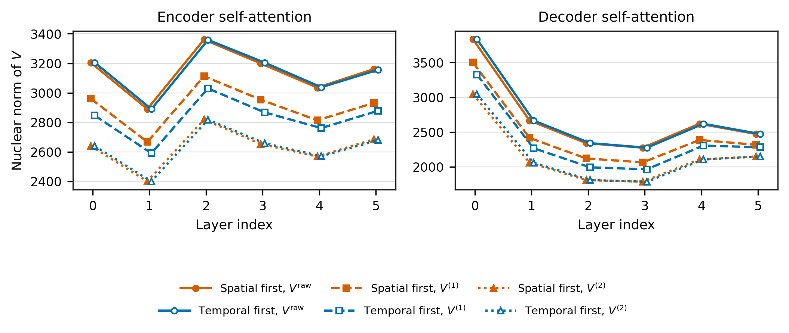

# Transformer 谱几何与 Value-Path 诊断研究档案

本仓库公开两条研究线：**方向 1** 关注小资源机器翻译微调中 **Encoder / Decoder 训练期几何与稳定性**；**方向 2** 关注 **Hessian 形式低秩 FFN（H-FFN）** 在记忆、因果语言建模与视觉上的方法原型。下文分别说明背景、方法与主要结论；方向 2 的代码与 smoke 脚本在 [direction-2-hessian-ffn/](direction-2-hessian-ffn/) 目录。

---

## 方向 1：Value 级联平滑在问什么？

级联平滑 **不是** 为了在充足数据与常规微调下调高 BLEU 的通用插件。它的主要用途是：

- 在 **平行句极少**（例如约 800 对）且 **优化步数很短** 时，给 Encoder / Decoder 的 **self-attention value 路径** 加上 **可控、可重复的读入算子**；
- 在 **训练过程中** 同步记录 **核范数、PPL、梯度峰值** 等指标，观察 **Encoder 与 Decoder 是否呈现不同的深度形态**，以及这些形态与 **损失尖峰、输出稳定性** 的关联有多强；
- 当 **AdamW 超参或标签编码不当** 导致 vanilla 微调明显掉点时，级联有时表现为 **相对 rescue**——这反映的是 **\(V\) 空间如何参与学习**（可写/不可写、前向低通），而不是「平滑本身等于更好的归纳偏置」。

在 **正确 `text_target` + 默认 AdamW + 全数据 1 epoch** 的对照下，vanilla 往往可达 ~20.8–21 BLEU；Scheme A **encoder-only、detach、legacy** 的级联与之接近。**请勿把旧 stress-test 下的 ~15 / ~18 数字与当前 matched 协议混谈**（见 [REPRODUCTION.md](REPRODUCTION.md)）。

### 方向 1 主图：Encoder / Decoder 随层「膨胀–压缩」差异

训练期（Scheme A 探针，\( \alpha_s{=}0.1,\ \alpha_t{=}0.2 \)，多种子平均）中，**同一级联算子** 在两侧堆叠上呈现 **不同的核范数深度曲线**：



| 模块 | 深度形态（定性） | 便于怎样读训练 |
|------|------------------|----------------|
| **Encoder** | 中段（约 layer 2）**抬升、保持较高容量**；双向表征在中层展开 | 与 **中间层 PPL/核范数** 联动时，常看到较平滑的压缩阶梯 |
| **Decoder** | 浅层 **范数最大**，向中层 **急剧压缩**（谷），深层部分回升 | 自回归 **历史→过滤→输出**；中层与 **train PPL 尖峰**、梯度峰值关联更强 |

级联三阶段在同一图里通常满足 **\( \|V^{\mathrm{raw}}\|_* > \|V^{(1)}\|_* > \|V^{(2)}\|_* \)**，说明算子主要起 **可度量的压缩探针** 作用；**Encoder vs Decoder 的形态差** 往往大于 spatial-first / temporal-first 的顺序差。更细的图注与数据表见 `part-a-mainline/05-results/` 下 Scheme A 归档说明。

### 方向 1 方法要点

1. **谱诊断语言**（script1–4）：点式激活如何改变秩、核范数、条件数。  
2. **Value 级联（Scheme A）**：在 **不改变 \(QK^\top\) 路由** 的前提下，对 **\(V\)** 做 spatial × temporal 两阶段混合；用于 **训练期探针**，而非默认推理必开。  
3. **Encoder-only + detach + legacy** 与 Scheme A 探针矩阵一致。

方向 1 详细索引：[part-a-mainline/README.md](part-a-mainline/README.md)；探索性负面结果：[part-b-explorations/README.md](part-b-explorations/README.md)。

---

## 方向 2：Hessian Feed-Forward Network（H-FFN）

### 背景

标准 Transformer 块中，FFN 占参数量与算力的主要部分，但结构仍是「扩维—非线性—投影」的静态 MLP，对每个 token 施加同一类映射。将 FFN 视为键值式联想记忆时，**变换表示** 与 **存放事实** 挤在同一条未索引的通道里，容易产生干扰；仅靠加宽中间层或 MoE，也难以显式刻画 **随输入变化的局部曲率**。

本方向把 FFN 写成由标量势 \(\Psi\) 诱导的 **Hessian 型算子**：在可学习的投影轴 \(u_j\) 上，用二阶门控 \(\lambda_j(x)=\psi''(u_j^\top x + b_j)\) 调节沿该方向的放大或抑制，整体保持与两层 MLP 相近的渐进计算量，但 **曲率与秩结构** 可解释、可探针。针对两类任务又衍生 **Memory-Track**（多尺度上下文门控，用于联想检索）与 **Decoupled H-FFN**（拆分内容、路由与发射，用于因果语言建模）；预训练迁移场景下可用 **解析 GELU 匹配** 做 FFN 暖启动。

### 方法

核心前向可概括为

\[
\text{H-FFN}(x)=\mathcal{H}(x)\,x=\sum_{j=1}^{m}\lambda_j(x)\,(u_j^\top x)\,u_j,
\quad
\Psi(x)=\sum_j \psi(u_j^\top x + b_j).
\]

实现中将 \(m\) 个秩一分支堆叠为低秩 Hessian 形式，并配合 **ctx-split**（上下文分裂读写）、**多尺度曲率阶梯** 与 **Decoupled** 变体。代码主入口为 `direction-2-hessian-ffn/tlb/ffn/hessian_core.py`，标准 MLP 对照为 `tlb/ffn/standard.py`；因果 LM、ctx-split 与 ViT FFN 替换见同目录下 `tlb/models/`。

`direction-2-hessian-ffn/` 收录 **可运行原型**（smoke 配置与代表脚本），不含完整实验流水线的全部 checkpoint 与私有数据。

### 结果（概要）

在与匹配训练预算的内部对照中，H-FFN 系列在以下三类任务上相对同规模 MLP 基线有一致趋势（本仓库不打包主表与方差明细）：

- **记忆 / 联想检索（Memory-Track）**：Needle-in-a-Haystack 类探测上，同预算下准确率显著高于匹配宽度的 MLP（主实验约 **96% 量级 vs 76% 量级**）。
- **因果语言建模（Decoupled H-FFN）**：WikiText-103 等语料上测试困惑度约 **1.1–1.4× 改善**（例如 WT103 约 **455 → 388** 量级）；流式 Web 教育语料上约 **1.15×** 量级。
- **视觉迁移**：GPT-2 FFN 解析替换微调约 **1.07×** PPL；ViT-B/16 上可在 **更少步数** 达到约 **+2.4% top-1** 的收敛表现。

示意性几何探针见 `direction-2-hessian-ffn/figures/memory_track_geom/`（迹链、曲率质量等，用于理解秩轨迹）。

### 方向 2 本仓库内容与快速开始

| 类别 | 路径（相对 `direction-2-hessian-ffn/`） |
|------|----------------------------------------|
| 记忆容量与轨道探针 | `experiments/run_memory_capacity_sweep.py`，`tlb/training/memory_track_probe.py` |
| 因果 LM（WT103 smoke） | `experiments/l4_causal_wt103_single.py`，`run_wt103_d256_lr_smoke.py`，`configs/wt103_scale_smoke/` |
| 视觉 smoke | `experiments/l_vit_cifar_smoke.py`，`vit_forward_smoke.py` |
| 数值 / 合成 smoke | `experiments/l0_smoke.py` |

```bash
cd direction-2-hessian-ffn
pip install -r requirements-snippet.txt
python experiments/l0_smoke.py
```

从本地算法树增量同步：`bash direction-2-hessian-ffn/scripts/sync_from_tlb_algorithm.sh`（默认源 `~/Desktop/TLB-Algorithm`）。WikiText 等数据需在本地 `TLB-Algorithm/data/` 准备。

方向 1 在 **attention 的 value 路径** 上做级联诊断；方向 2 在 **FFN 子层** 用 Hessian 低秩结构处理记忆、因果建模与视觉。二者共享「谱 / 秩 / 曲率」语言，但 **干预位置与任务设定不同**。子目录 [direction-2-hessian-ffn/README.md](direction-2-hessian-ffn/README.md) 与主页本节保持同一口径，便于单独浏览。

---

## 仓库结构

```
part-a-mainline/          方向 1：合成谱理论、ViT 桥、Marian value 级联与归档结果
part-b-explorations/      方向 1：未走通的 Q/K/V、memory 等探索
direction-2-hessian-ffn/  方向 2：H-FFN 原型（记忆 / 因果 LM / 视觉）
figures/gallery/          方向 1 主 README 用图（当前以 07 为主）
REPRODUCTION.md           方向 1 复现步骤与协议说明
```

---

## 快速开始（方向 1）

```bash
pip install -r requirements.txt
cd part-a-mainline/01-theory-scripts && python script2_universal_validation.py
```

完整流程：[REPRODUCTION.md](REPRODUCTION.md)

---

## 引用与同步

供学术复现与过程审阅；引用请注明仓库 URL。

本地完整实验树：`~/Desktop/TLB-Experiments/`（方向 1）、`~/Desktop/TLB-Algorithm/`（方向 2 源）。
