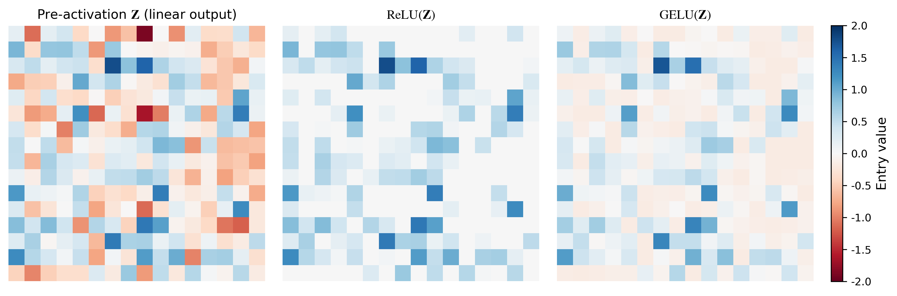

# Transformer 谱几何与 Value-Path 诊断研究档案

> **Diagnostic study of how pointwise activations reshape matrix spectra in Transformers, and how a spatial–temporal value cascade behaves under low-resource Marian adaptation.**

本仓库是一次完整研究过程的公开档案：从「激活函数如何扭曲特征矩阵的谱」出发，经过多轮假设检验，最终形成 **只编辑 attention value 路径、不改动 QK 路由** 的诊断级联方法。我们**同时保留**走通的主线与被实验否定的分叉，便于他人理解科学过程而非仅看最终公式。



---

## 我们在问什么？

Transformer 块由 **多头注意力（MHA）** 与 **FFN 点式激活** 共同构成。大量工作优化注意力路由；我们则关注一个相对被忽视的问题：

**点式非线性（ReLU、GELU、SiLU…）如何在深度上累积地改变特征矩阵与 value 张量的秩、核范数、条件数？这种「谱几何」能否成为跨模块、跨任务的统一诊断语言？**

在此之上，我们进一步问：当预训练 Marian 模型在 **极少平行句（800 对）** 上微调时，若对 Q/K/V 或 FFN 做「看似合理」的几何干预，会发生什么？是否存在 **只动 value、不动路由** 的受控探针，能在 stress-test 下既避免崩溃、又揭示 encoder/decoder 的不对称？

---

## 核心假设（按时间顺序）

| # | 假设 | 结果 | 所在位置 |
|---|------|------|----------|
| H1 | 点式激活系统性重塑谱；深度放大条件数病态 | ✅ 成立 | [Part A — 合成理论](part-a-mainline/01-theory-scripts/) |
| H2 | 直接规整 Q/K/V 核范数或改 Q–K 耦合可提升低资源 MT | ❌ 崩溃（BLEU→0） | [Part B — Q/K 实验](part-b-explorations/) |
| H3 | 正交「记忆通道」可保留长程信息 | ❌ dual ≈ baseline | [Part B — script8](part-b-explorations/code/script8_dual_space_memory.py) |
| H4 | 仅平滑 **value 路径**（不动 QK）可 regularize 适应 | ⚠️ 部分有效 → 引向 cascade | Part A + [V-smooth 搜索摘要](part-b-explorations/summaries/v_smooth_experiments_summary.md) |
| H5 | **Spatial × temporal 两阶段 value 级联** 是可行的诊断算子 | ✅ 主线方法 | [Part A — Scheme A](part-a-mainline/03-marian-cascade/) |
| H6 | Decoder 比 Encoder 更 fragile（PPL/梯度/空间平滑敏感） | ⚠️ 有诊断证据，理论未完全闭合 | Part A 结果 + 讨论 |

---

## 仓库结构

```
part-a-mainline/          论文主线：可复现的核心 claim
  01-theory-scripts/      script1–4：合成谱散射
  02-vit-bridge/          script5/7：ViT ↔ Marian 几何桥（观测性）
  03-marian-cascade/      value 级联、Scheme A 探针、Marian 微调
  04-data/                OPUS de–en 子集（800 train / 128 val 用法）
  05-results/             CSV、JSON、论文图（无 20GB grid checkpoint）
  06-checkpoints/         1× vanilla finetune (seed 42) + eval 清单

part-b-explorations/      负面与探索性实验（按时间线）
  code/                   script8–11、tlb_attention_core
  summaries/              collapse JSON、对齐指南、讨论笔记

figures/gallery/          README 用精选可视化（10 张）
REPRODUCTION.md           复现步骤与两套 finetune 协议
SIZE_AUDIT.md             体积预算与未打包的大目录说明
```

---

## Part A — 主线（三张图读懂故事）

### 1. 激活即「谱散射」（script1–4）

对随机特征矩阵施加 $Z=WX$，再做点式 $\sigma(Z)$，测量 rank、核范数 $\|\cdot\|_*$、条件数 $\kappa$。结论：

- 平滑激活相对线性基线 **压低核范数、改善 $\kappa$**；
- ReLU 等可将能量 **挤向 leading singular direction**；
- 堆叠深度后，条件数病态 **显著累积**（见 gallery `02`、`03`）。

→ 这提供了后文所有「探针指标」的语言。

### 2. 预训练几何桥（ViT + Marian overlay）

冻结 ViT 做层wise SVD；对比 random init vs pretrained 的 $c_\ell$ 曲线（gallery `05`、`06`）。**观测性结论**：预训练几何与纯随机初始化不同，但 Marian 适应 stress-test 的机理仍主要在 value/FFN 耦合，而非单独 QK 路由。

### 3. Marian value 级联（Scheme A）

在 **Helsinki OPUS-MT de–en** 上，用 800 句微调作为 controlled stress test：

| 阶段 | BLEU（量级） | 含义 |
|------|-------------|------|
| 预训练直接推理 | **~19.9** | 基座并不弱 |
| 朴素 1 epoch 微调 | **~15.5** | 小数据即可打偏几何 |
| 改 Q/K/V 谱或 FFN 激活 | **→0** |  naive 几何编辑危险 |
| Value 级联（Scheme A） | **~17.5–18.5** | 诊断性 rescue，非 SOTA |

级联在 value 投影之后、聚合之前做 **spatial（跨 head）→ temporal（跨 token）** 或反向两阶段平滑；Encoder/Decoder 可分别探针（gallery `07–10`）。

**读结果时注意**：完整 stress-test 用 `marian_mt_finetune_tlb.py`；Scheme A 矩阵默认 **32 batch** 探针协议（`run_probe_independent.py`），vanilla 退化较轻 — 详见 [REPRODUCTION.md](REPRODUCTION.md)。

---

## Part B — 我们试过但走不通的路

诚实记录「为什么最后只动 value」：

1. **Q/K/V 核范数投影**（`results_marian_qkv_proj_nuc`）→ BLEU ≈ 0  
2. **kv_inner / Q–K 耦合变体**（`tlb_attention_core.py`）→ 微调崩溃  
3. **正交 dual-memory 通道**（script8）→ 长序列 copy 任务无稳定优势  
4. **FFN 中段双空间 / token mirror**（script9–10）→ 未迁移到 Marian 增益  
5. **V-smooth 网格搜索**（~16GB checkpoint，未打包）→ 过程见 summary，引向 cascade  

详见 [part-b-explorations/README.md](part-b-explorations/README.md)。

---

## 快速开始

```bash
# 1. 环境
pip install -r requirements.txt

# 2. 合成实验（CPU，数分钟）
cd part-a-mainline/01-theory-scripts && python script2_universal_validation.py

# 3. 核对已归档数字（无需 GPU）
cat part-a-mainline/05-results/results_marian_ffn_frozen_eval/summary.json
cat part-a-mainline/05-results/results_probe_independent/schemeA_3x2x3_20260424_0137/schemeA_full_report.md

# 4. 重 eval 已打包 checkpoint（需 GPU + transformers）
cd part-a-mainline/03-marian-cascade
python marian_mt_finetune_tlb.py \
  --checkpoint ../06-checkpoints/vanilla_finetune_seed42 \
  --eval-only --max-val 128 --seed 42
```

完整流程：[REPRODUCTION.md](REPRODUCTION.md)

---

## 可视化索引

| 图 | 文件 | 内容 |
|----|------|------|
| 01 | `figures/gallery/01_activation_triptych.png` | 激活前后特征热力图 |
| 02 | `02_script3_depth_conditioning.png` | 深度–条件数网格 |
| 03 | `03_script4_val_loss.png` | 玩具 Transformer 去噪 |
| 05 | `05_vit_marian_c_geometry.png` | Random vs pretrained $c_\ell$ |
| 07–10 | `07`–`10_*.png` | Scheme A 核范数、heatmap、PPL |

---

## 引用与许可

研究档案供学术复现与过程审阅。若使用代码或归档结果，请引用仓库 URL（正式论文版本暂未公开）。

**未包含在本仓库**：投稿用 LaTeX 全文、审稿 correspondence、rebuttal 原文（保留在本地 private）。

---

## 同步源码

本地完整工作区（含未打包的大 grid）路径：`~/Desktop/TLB-Experiments/`  
从此处更新 staging：

```bash
bash scripts/copy_from_tlb.sh && bash scripts/supplement_repro_assets.sh
```
