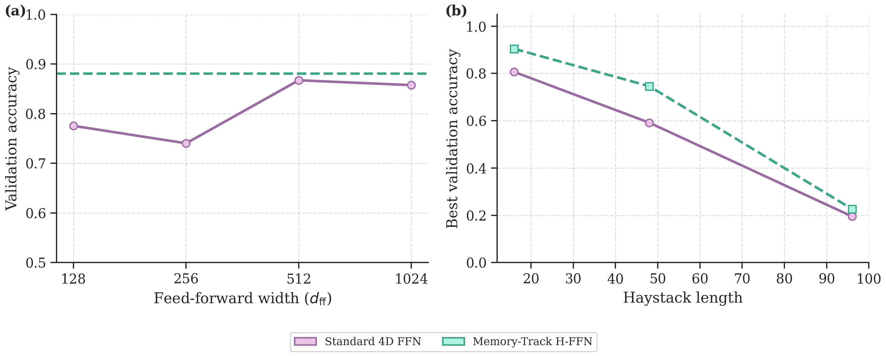

# 方向 2：Hessian Feed-Forward Network（H-FFN）

**仓库主页**已收录本节的背景、方法、结果与快速开始（见根目录 [README.md](../README.md) 中「方向 2」）。此处便于 **仅浏览方向 2 代码树** 时使用。

## 背景

标准 Transformer 块中，FFN 占参数量与算力的主要部分，但结构仍是「扩维—非线性—投影」的静态 MLP。将 FFN 视为联想记忆时，**变换表示** 与 **存放事实** 共用未索引通道，易产生干扰。本方向用标量势 **Ψ** 定义 Hessian 型 FFN：在投影轴 **u_j** 上用 **λ_j(x) = ψ''(u_j·x + b_j)** 做二阶门控，并配合 **Memory-Track**、**Decoupled H-FFN** 与 **ctx-split** 等变体。

## 方法

```
H-FFN(x) = H(x)·x = Σ_j  λ_j(x) · (u_j·x) · u_j
```

实现：`tlb/ffn/hessian_core.py`（对照 `tlb/ffn/standard.py`）。

## 主图（记忆任务）



Needle-in-a-Haystack / 容量压力下，Memory-Track 相对匹配 MLP 保持更高检索准确率（约 **96% vs 76%** 量级，同预算主实验）。

## 结果（概要）

- **因果 LM**：WT103 困惑度约 **455 → 388**（约 1.1–1.4×），见 gallery `d2_02_wt103_ppl.png`。  
- **视觉**：GPT-2 FFN 替换约 **1.07×** PPL；ViT-B/16 约 **+2.4% top-1**、更少步数收敛。  
- **几何探针**：`d2_03_memory_trace_chain.png`（迹链秩轨迹）。

## 代码与运行

| 类别 | 路径 |
|------|------|
| 记忆 | `experiments/run_memory_capacity_sweep.py`，`tlb/training/memory_track_probe.py` |
| 因果 LM | `experiments/l4_causal_wt103_single.py`，`run_wt103_d256_lr_smoke.py` |
| 视觉 | `experiments/l_vit_cifar_smoke.py` |

```bash
pip install -r requirements-snippet.txt && python experiments/l0_smoke.py
```
